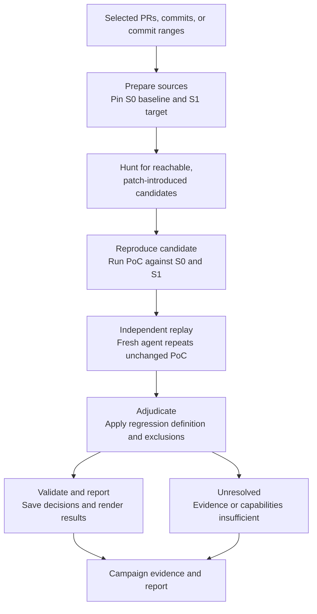

# Regression Hunt

Regression Hunt is an agent-orchestrated workflow for identifying, reproducing, and verifying
regressions introduced by software changes.

It investigates pull requests, commits, and commit ranges by coordinating specialized agents
across source preparation, candidate discovery, reproduction, independent replay, adjudication,
and reporting.

The workflow requires reproducible evidence before confirming a regression. It distinguishes
confirmed regressions from incomplete fixes, latent bugs, pre-existing bugs, and unresolved
findings.

The host supplies agent dispatch, authentication and tools. No custom model adapter or Python
service is required.

Start with [regression-hunt](skills/regression-hunt/SKILL.md). Supply a change list, a campaign
directory outside the plugin, and execution/resource limits. PRs may be open, closed or merged;
local commits and explicit ranges are supported.

The coordinator and standalone skills use any root `AGENTS.md`,
`PATCHING_GUIDELINES.md` and `THREAT_MODEL.md` as described in the
[project guidance](references/evidence.md#project-guidance).

## Quick Start

1. **Make the plugin's skills available to your agent host.** The host must support agent
   dispatch and provide the authentication and tools needed to inspect the repository and run
   authorized build, deployment and test commands.
2. **Prepare a change list.** Include pull request URLs, or repository paths with commit SHAs.
   For a commit range, identify the baseline and target revisions explicitly. See the
   [example request](examples/request.md) for supported inputs.
3. **Choose a campaign directory outside this plugin.** This directory stores the scope,
   evidence, stage results and decisions. Keep it if you want to resume the investigation.
4. **Set execution and resource limits.** Specify the permitted environment, time, CPU and
   memory constraints, plus any restrictions on network access or infrastructure.
5. **Ask your coordinating agent to run the workflow.** For example:

   ```text
   Use regression-hunt to investigate the changes in my change list.
   Save the campaign in ./regression-campaign.
   Use local execution within the available CPU and memory limits.
   Delegate through the host's agent tools. Report confirmed regressions
   and unresolved candidates separately.
   ```

To continue an existing investigation, invoke the skill again and provide the same campaign
directory. The coordinator can inspect saved state and resume eligible work. See the
[full example request](examples/request.md) for resume and report-only prompts.

## Lifecycle

The coordinator manages the campaign and delegates each stage to focused skills and agents.
The workflow moves from change selection to evidence-backed decisions:



A candidate is confirmed only when the evidence supports the affected behavior, reachability,
and causality, and an independent agent successfully replays the proof. Candidates that do not
meet the confirmation requirements remain unresolved; they are not reported as confirmed
regressions. See the [regression definition](docs/regression-definition.md) and
[system flow](docs/system-flow.md) for the full criteria and stage handoffs.

## Skills

| Skill | Responsibility |
| --- | --- |
| [regression-hunt](skills/regression-hunt/SKILL.md) | Delegate, track progress and resume |
| [prepare-regression](skills/prepare-regression/SKILL.md) | Pin sources and PR/commit context |
| [hunt-regressions](skills/hunt-regressions/SKILL.md) | Identify reachable patch-introduced candidates |
| [reproduce-regression](skills/reproduce-regression/SKILL.md) | Deploy both states and execute a PoC |
| [replay-regression](skills/replay-regression/SKILL.md) | Independently repeat the unchanged PoC |
| [adjudicate-regression](skills/adjudicate-regression/SKILL.md) | Apply the definition and exclusions |
| [report-regressions](skills/report-regressions/SKILL.md) | Validate and render saved decisions |

See the [system flow](docs/system-flow.md), [definition](docs/regression-definition.md),
[file handoffs](references/evidence.md), [report labels](docs/report-definitions.md) and
[example request](examples/request.md). Every packaged helper and reference is inside this
plugin.

## Deterministic helpers

The standard-library scripts require Python 3.13+; invoke them with uv. They do not start
agents, schedule stages or decide whether reasoning is correct.

- [snapshot.py](scripts/snapshot.py): export explicitly selected Git revisions and their diff.
  Requires Git supporting `check-attr --source`. Unsupported LFS/submodule/export-attribute
  cases need explicit source preparation by the agent; failures explain what is missing.
- [evidence.py](scripts/evidence.py): seal and verify complete evidence packages and dependencies.
- [registry.py](scripts/registry.py): freeze scope, reserve IDs and validate assignments/results.
  Binding and retries require coordinator-captured host evidence. Uses POSIX file locks.
- [report.py](scripts/report.py): validate structural proof requirements and render HTML/Markdown/JSON.

Fresh independent agents and authorized execution tools are needed to confirm a finding.
Missing capabilities leave candidates unresolved. Cloud infrastructure is optional and must be
authorized; this plugin does not provision it automatically.

## Development

Run `uv sync --frozen` and `uv run --frozen pytest` from this plugin directory for behavioral
tests. The repository's `make check` also runs these tests and checks formatting and lint.
