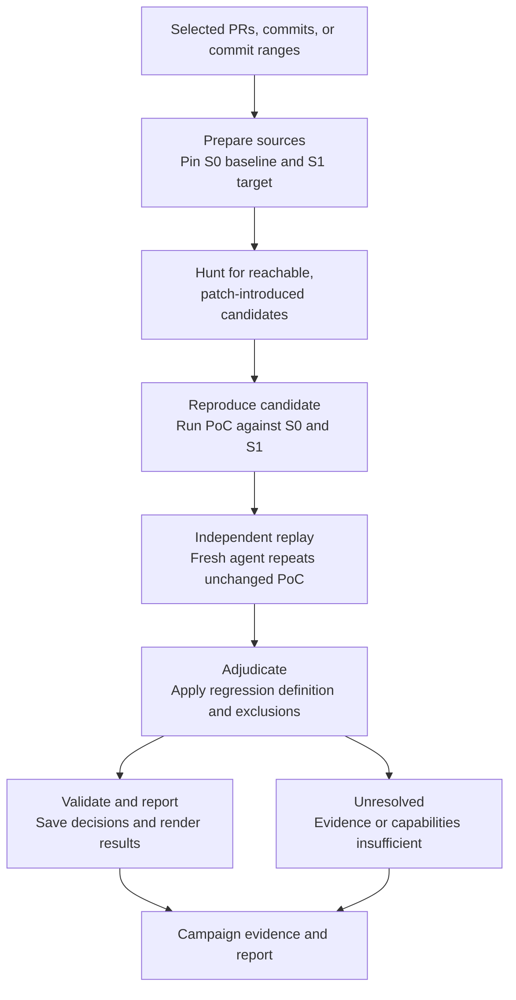

# Regression Hunt

Regression Hunt is an agent-orchestrated workflow for identifying, reproducing, and verifying
regressions introduced by software changes.

It investigates pull requests, commits, and commit ranges by coordinating specialized agents
across source preparation, candidate discovery, reproduction, independent replay, adjudication,
and reporting.

The workflow requires reproducible evidence before confirming a regression. It distinguishes
confirmed regressions from incomplete fixes, latent bugs, pre-existing bugs, and unresolved
findings.

The host supplies agent dispatch, authentication and tools. No custom model adapter or Python
service is required.

Start with [regression-hunt](skills/regression-hunt/SKILL.md). Supply a change list, a campaign
directory outside the plugin, and execution/resource limits. PRs may be open, closed or merged;
local commits and explicit ranges are supported.

The coordinator and standalone skills use any root `AGENTS.md`,
`PATCHING_GUIDELINES.md` and `THREAT_MODEL.md` as described in the
[project guidance](references/evidence.md#project-guidance).

## Quick Start

1. **Make the plugin's skills available to your agent host.** The host must support agent
   dispatch and provide the authentication and tools needed to inspect the repository and run
   authorized build, deployment and test commands.
2. **Prepare a change list.** Include pull request URLs, or repository paths with commit SHAs.
   For a commit range, identify the baseline and target revisions explicitly. See the
   [example request](examples/request.md) for supported inputs.
3. **Choose a campaign directory outside this plugin.** This directory stores the scope,
   evidence, stage results and decisions. Keep it if you want to resume the investigation.
4. **Set execution and resource limits.** Specify the permitted environment, time, CPU and
   memory constraints, plus any restrictions on network access or infrastructure.
5. **Ask your coordinating agent to run the workflow.** For example:

   ```text
   Use regression-hunt to investigate the changes in my change list.
   Save the campaign in ./regression-campaign.
   Use local execution within the available CPU and memory limits.
   Delegate through the host's agent tools. Report confirmed regressions
   and unresolved candidates separately.
   ```

To continue an existing investigation, invoke the skill again and provide the same campaign
directory. The coordinator can inspect saved state and resume eligible work. See the
[full example request](examples/request.md) for resume and report-only prompts.

## Lifecycle

The coordinator manages the campaign and delegates each stage to focused skills and agents.
The workflow moves from change selection to evidence-backed decisions:



A candidate is confirmed only when the evidence supports the affected behavior, reachability,
and causality, and an independent agent successfully replays the proof. Candidates that do not
meet the confirmation requirements remain unresolved; they are not reported as confirmed
regressions. See the [regression definition](docs/regression-definition.md) and
[system flow](docs/system-flow.md) for the full criteria and stage handoffs.

## Terminology

| Term | Meaning |
| --- | --- |
| **Campaign** | A persistent investigation workspace containing the frozen scope, evidence, stage results, and decisions. |
| **Change** | A selected pull request, commit, or commit range being investigated. |
| **Candidate** | A suspected regression identified during analysis but not yet confirmed. |
| **S0 (baseline)** | The source state before the selected change; used to establish previously correct behavior. |
| **S1 (target)** | The source state containing the selected change; compared with S0 to test whether behavior regressed. |
| **PoC (proof of concept)** | An executable test or demonstration used to reproduce the suspected behavior. |
| **Coordinator** | The agent running the `regression-hunt` skill; it manages scope, delegates stages, tracks evidence, and resumes work. |
| **Host** | The agent platform that provides dispatch, authentication, and execution tools to the coordinator and specialist agents. |

A candidate is not a confirmed regression until it meets the evidence and independent-replay
requirements described in the [regression definition](docs/regression-definition.md).

## Skills

| Skill | Responsibility |
| --- | --- |
| [regression-hunt](skills/regression-hunt/SKILL.md) | Delegate, track progress and resume |
| [prepare-regression](skills/prepare-regression/SKILL.md) | Pin sources and PR/commit context |
| [hunt-regressions](skills/hunt-regressions/SKILL.md) | Identify reachable patch-introduced candidates |
| [reproduce-regression](skills/reproduce-regression/SKILL.md) | Deploy both states and execute a PoC |
| [replay-regression](skills/replay-regression/SKILL.md) | Independently repeat the unchanged PoC |
| [adjudicate-regression](skills/adjudicate-regression/SKILL.md) | Apply the definition and exclusions |
| [report-regressions](skills/report-regressions/SKILL.md) | Validate and render saved decisions |

See the [system flow](docs/system-flow.md), [definition](docs/regression-definition.md),
[file handoffs](references/evidence.md), [report labels](docs/report-definitions.md) and
[example request](examples/request.md). Every packaged helper and reference is inside this
plugin.

## Runtime requirements

Regression Hunt runs inside an agent host; it does not provide its own agent runtime. The host
must provide:

- **Agent orchestration:** the ability to dispatch specialist agents and manage their execution.
- **Repository access:** authentication and tools to inspect the selected PRs, commits, and
  source revisions.
- **Authorized execution:** tools and an environment to build, deploy, and test the software
  under investigation. These are needed to reproduce and independently replay a candidate.
- **Persistent campaign storage:** a writable directory outside the plugin for scope, evidence,
  stage results, and decisions.

The packaged helper scripts have additional, conditional requirements:

- **Python and uv:** Python 3.13+ and [uv](https://docs.astral.sh/uv/) are required to run the
  standard-library helper scripts. These scripts support the workflow; they do not start agents,
  schedule stages, or decide whether reasoning is correct.
- **Git:** [snapshot.py](scripts/snapshot.py) requires a Git version that supports
  `check-attr --source`. Unsupported LFS, submodule, or export-attribute cases require explicit
  source preparation by the agent; the script reports what is missing.
- **POSIX file locks:** [registry.py](scripts/registry.py) uses POSIX file locks.

The other helpers provide the following functions:

- [evidence.py](scripts/evidence.py): seal and verify complete evidence packages and dependencies.
- [report.py](scripts/report.py): validate structural proof requirements and render HTML, Markdown,
  and JSON reports.

Fresh independent agents and authorized execution tools are required to confirm a finding.
If those capabilities are unavailable, candidates remain unresolved. Cloud infrastructure is
optional, must be authorized, and is not provisioned by this plugin.

## Development requirements

For behavioral tests, run `uv sync --frozen` and `uv run --frozen pytest` from this plugin
directory. The repository's `make check` also runs these tests and checks formatting and lint.
