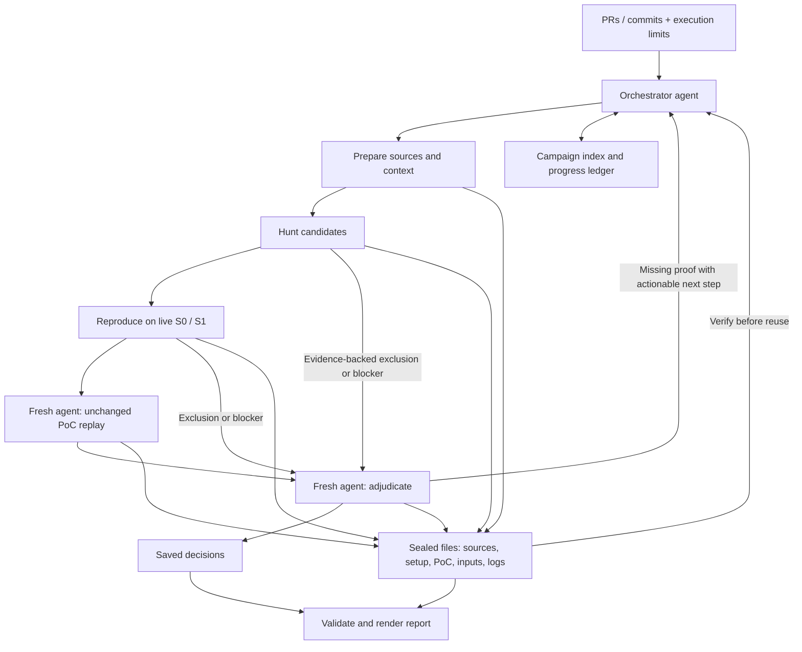

# System flow

The host's main agent runs the orchestrator skill. Specialized agents read instructions and
evidence files, execute through their available tools, and save results. Python helpers never
select or launch agents.

Independent changes/candidates can run concurrently. Each agent owns a separate attempt
directory; the orchestrator alone writes the index. Reproduction, replay and adjudication use
distinct fresh contexts. Replay gets the entire deployment package, not just PoC text.

The [registry helper](../scripts/registry.py) reserves prefixes, candidate IDs and attempt IDs
in `registry.json`. Before dispatch, the coordinator freezes the original change list in
`scope.json` with registry `init`. Reports must retain every scoped change and use its assigned
packages. The coordinator binds each handle with host evidence of an isolated environment
(`isolated`) or with the agent tool's spawn record for a fresh-context agent on a shared machine
(`shared-host`), then accepts sealed results before updating the index. Reports show each confirmed
finding's weakest level.

Retries require termination evidence of the same kind as the launch. They preserve candidate IDs
and supersede old attempts; late results are rejected. The helper validates retained records but
cannot authenticate them or stop agents. Missing launch or terminal records block dispatch or
retry. See the [file contract](../references/evidence.md).

Artifacts and prerequisite records are hashed. Resume checks those hashes and saved agent
handles before deciding what remains. Changed sources or PoCs require new downstream attempts.
The agent chooses retries and order; confirmation gates are mandatory.

Confirmation requires supported behavior, reachability, correct S0/failed S1, patch-introduced
causality, exclusions ruled out and independent live replay. The validator checks recorded
structure and integrity. Agents and human reviewers must establish that the evidence is true.
